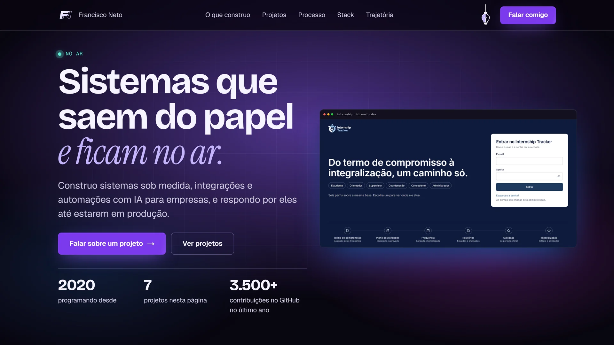

<div align="center">
  

  <h1>Francisco Neto</h1>

  <p><strong>Do pedido à produção.</strong><br>Meu portfólio, construído como um produto.</p>

  <a href="https://chiconeto.dev/"><strong>chiconeto.dev</strong></a>

  <br><br>

  
  
  
  
  
</div>

<br>



## O projeto

A página conta uma história: abre no escuro, a rolagem acende a luz, os sistemas entram em cena e tudo termina no estado "no ar". É a mesma ideia do que eu entrego, um único responsável do primeiro pedido até a produção.

Este repositório é um trabalho autoral. Conceito, design, conteúdo e código são de minha autoria e responsabilidade.

## O que há para ver

- **Abertura em palco:** a luz, os prints reais e a proposta são controlados pela posição da rolagem.
- **O que eu construo:** sete frentes em um palco fixo, cada uma com a própria luz e uma ilustração animada.
- **Projetos:** sete casos em janelas de navegador, com problema, solução, stack e resultado.
- **Demonstração interativa:** as regras reais de ativação de estágio do Internship Tracker, para testar direto na página do projeto.
- **Atividade no GitHub:** meus dados reais, percorridos por uma cobra de luz em zigue-zague.
- **Lâmpada no topo:** claro, escuro ou sistema, com a troca nascendo da própria lâmpada.

## Stack

| Área | Tecnologias |
|---|---|
| Base | Next.js 16 (App Router), React 19, TypeScript |
| Estilo | Tailwind CSS 4 e design system próprio em CSS |
| Movimento | CSS, View Transitions API e Lenis para a rolagem suave |
| Conteúdo | Dados tipados em um único arquivo, ícones reais com React Icons |
| Infraestrutura | Docker em build `standalone`, VPS própria e proxy reverso com HTTPS automático |
| Entrega | GitHub Actions e deploy a partir da `main` |

## Decisões técnicas

**Movimento sem biblioteca de animação.** A rolagem escreve uma única variável, `--p`, de 0 a 1, e o CSS deriva dela luz, opacidade e posição. O efeito é rico, com pouco JavaScript no navegador.

**A primeira tela não espera o JavaScript.** O hero anima só com CSS e a logo vem embutida na folha de estilo. As seções fora da tela usam `content-visibility`, e o Lenis e o calendário do GitHub são baixados sob demanda.

**Acessível por padrão, não por exceção.** Todo efeito depende de `prefers-reduced-motion: no-preference` e de JavaScript ativo. Sem isso, a página aparece inteira e parada. O contraste das paletas segue o WCAG AA.

**Tema sem flash.** Um script no `<head>` aplica o tema antes da primeira pintura. O modo Sistema é o padrão e acompanha o sistema operacional ao vivo.

**Um design system, não estilos soltos.** Cor, luz, espaço, tipografia e movimento são tokens. As folhas clara e violeta só redefinem esses tokens, e todo componente dentro delas se adapta.

**Prints reais, sempre nítidos.** Capturados em 2880 px, servidos no tamanho certo para cada tela e apresentados por um único componente de janela.

**Deploy sem acesso amplo.** A chave usada pelo CI só consegue disparar o deploy. O contêiner roda sem root, em modo somente leitura, sem capabilities do Linux e com limite de memória.

## Estrutura

```
src/
├── app/
│   ├── styles/                # palettes, tokens, components, visuals, motion e scenes
│   ├── projetos/[slug]/       # Página de cada projeto
│   └── page.tsx               # A narrativa da home
└── components/portfolio/
    ├── lib/                   # Conteúdo, tema, efeitos e componentes compartilhados
    └── sections/              # Uma seção por arquivo
```

## Rodando localmente

```bash
npm install
npm run dev     # servidor de desenvolvimento
npm run check   # tipos, lint e build de produção
```

## Autoria e licença

Criado e mantido por **[Francisco Neto](https://chiconeto.dev/)**.

© 2026 Francisco Neto. Todos os direitos reservados. O código está público para consulta, mas não pode ser copiado, modificado ou redistribuído sem autorização por escrito. Veja a [licença](./LICENSE).
